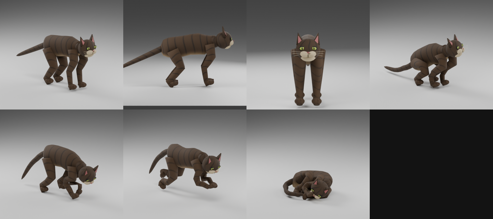

# Ewing's Animals 0.1.2 prototype

Standalone mod ID `EwingsAnimals`; target inspected B42.21 / Steam25485521,
Windows. Original brown tabby cats using native raccoon motions and native
animal care. No companion/follow/command system, breeding or automatic spawns.
Native raccoons are unchanged. This update is offline tested; gameplay,
existing-save repair and multiplayer are not certified.

*Offline adult Blender renders, not game screenshots. Kittens currently reuse
the original adult geometry at smaller scale, without juvenile-specific anatomy.*

## Changes and pickup diagnosis

The former adult stage had `ageToGrow=0`. B42.21 `AnimalData.initWeight` divides
the weight range by the current stage duration, even for a terminal adult.
At age=minAge, infinity multiplied by zero yields NaN; the native pickup
comparison then fails. This arithmetic regression was reproduced in the
installed JVM. Adult duration is now 60, matching terminal native raccoon
adults. No nextStage is added to adults, so they remain adults.

The reported live animal's stored weight was not inspected. This is a proven
definition defect, not a claim that every runtime cause has been eliminated.
A cat-only handling line shows actual weight and the pickup limit; right-click
also logs the loaded type, weight, native pickup result, attachment, wild and
animal-cheat state. This diagnostic changes no animal data.

Native pickup requires `canBePicked` and weight strictly below
`40 + 7 * Strength`, apart from native god/unlimited-carry exceptions. There is
no acceptance or rope threshold. Native path adjacency and timed-action
distance/existence checks remain. Successful pickup creates `Base.Animal`,
puts the animal in inventory/hands and clears its wild flag. No pickup bypass
or replacement action is included. Rope attachment is disabled on both types;
vanilla animal-cheat mode can still display its own rope option.

Adults retain native raccoon wild/flee flags, wander interval, turn rate and
motion system, with lower configured weight. The zero-duration repair and
solid hand-food access address defects without making every adult instantly
tame. Stress, acceptance and inherited genetic disorders remain native.

## Kittens, feeding and petting

Stable adult: `ewingsanimals_catadult`; new kitten: `ewingsanimals_kitten`;
group: `ewingsanimals_cat`; breed: `ewingsanimals_browntabby`.
Kittens start non-wild with `alwaysFleeHumans=false`, using the native domestic
fear/acceptance branch. This is friendly behavior, not fixed acceptance or
immunity to panic/zombies/stress. Scale 0.5-0.9 and growth baseline 60 days
come from native raccoon kits. Genes can affect growth duration. Both sexes
grow into the stable adult type; no mates, pregnancy or birth system is added.

Native hand-feeding's initial inventory filter omits CatFood/Meat/Fish food
categories. A cat-only context-menu event adds **Offer cat food** when hungry
(native world-menu hunger threshold 0.1), offering fresh non-spice permitted
solid food from inventory. It calls the existing native feeding callback and
timed action, which handle consumption, stress and player acceptance. Other
species and vanilla methods are unchanged. Ground/trough diet remains cat
food, meat and fish. Pure CowMilk or AnimalMilk keeps vanilla fluid feeding;
mixed/other milk is not claimed. Water remains a separate need.

The group reads **Cats**. Both types use native **Pet**, stress reduction,
acceptance, Husbandry effects and cooldown. Cat-only player animation nodes
reference native low-petting clips and completion events, including dwarf
adult selection. No custom stress numbers, affection or companion AI exists.
Exact hand/head alignment and menu integration need runtime acceptance.

Livestock zones encourage staying; they are not fences. Provide accessible
food/water and close physical exits. Native stress/pathing can still matter.

## Install and disposable test

Fully exit PZ before replacing files. Extract the install ZIP so the selected
user-data mods directory contains `EwingsAnimals/42/mod.info` and sibling
`EwingsAnimals/common/`. Back up the old mod outside active mods folders;
replace only this mod, enable it and restart. Packaging does not install it.

In a disposable debug world, use the native animal spawn menu with either type
above and breed `ewingsanimals_browntabby`, live/non-skeleton. Test a new adult
and kitten with animal cheats/god/unlimited carry disabled and no rope. Check
Pick Up, inventory/drop, food, native petting and diagnostic weight. See
ACCEPTANCE.md for the full matrix. No custom spawn command is required.

Existing saved cats preserve wild status, stress, acceptance and possibly an
invalid saved weight. A restart reloads definitions; it is not a certified
repair of previously stored NaN data. No save migration or automatic data
rewrite is included. Prefer a fresh disposable cat for first verification;
if an older cat reports NaN, retain that diagnostic rather than editing a
valuable save. Existing adults are not converted to kittens.

Original mesh, coat, icon and packed Blender source are unchanged from 0.1.0.
The source ZIP includes authoring assets, tools and verification reports;
Blender/Python are not required to play. Raccoon gait/crouches and angular
geometry remain visible. No native game artwork or motion payloads are bundled.
Persistent custom entities require the mod; do not remove it from a valuable
world containing cats without a backup. Rollback tests belong in disposable
worlds. Multiplayer and save/reload acceptance remain pending.
